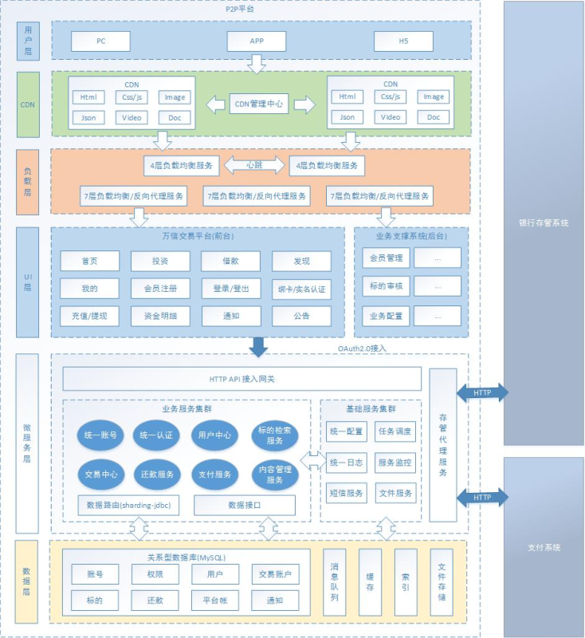

<div align="center">

# 心飞金融 P2P 平台

**互联网金融解决方案 | 理财 · 借贷 · 风控 · 银行存管一体化**


</div>

---

## 项目简介

**心飞金融** 是一款面向互联网大众的金融平台，提供 **P2P 理财服务** 和 **个人消费信贷服务**，依托大数据风控技术，实现安全、快捷、稳定的金融服务。

系统核心价值：

- **业务闭环**：覆盖开户、借贷、出借、风控、还款、对账全流程
- **技术先进**：Spring Boot 4 + Spring Cloud 2025 微服务架构，分布式事务保障数据一致性
- **合规安全**：银行存管系统对接，资金流向透明，符合金融监管要求

### 核心功能

| 功能域 | 说明 |
|--------|------|
| 统一认证 | OAuth2 授权码模式 + JWT 令牌，支持密码 / 短信验证码登录 |
| 统一账户 | 用户开户、银行卡绑定、余额管理 |
| 用户中心 | 个人信息、实名认证（百度 AI）、资产总览 |
| 交易中心 | 标的管理、出借投标、满标放款 |
| 还款服务 | 还款计划生成、按期还款、逾期处理 |
| 存管代理 | 对接银行存管系统，资金流水同步 |
| 全文检索 | Elasticsearch 标的多条件检索 |

---

## 功能模块


**核心模块**：

1. **交易平台**：用户出借、借款、标的全生命周期管理
2. **风控管理**：身份认证、征信评估、风险控制
3. **存管对账**：银行存管数据同步与差异校验

---

## 技术架构



**核心设计原则**：

- **微服务化**：基于 Spring Cloud 拆分为 12 个模块，Eureka 服务注册与发现
- **网关统一入口**：Spring Cloud Gateway 统一路由、鉴权、限流
- **配置外置**：Apollo 配置中心集中管理各环境配置
- **数据分层**：OLTP（MySQL + ShardingSphere 分库分表）与检索（Elasticsearch）分离

### 技术栈总览

| 层级 | 技术选型 |
|------|----------|
| **基础框架** | JDK 25 + Spring Boot 4.1.1 + Spring Cloud 2025.1.3 |
| **前端** | 管理后台 Vue 3 + Element Plus + Vite / 移动端 uni-app（Vue 3） |
| **网关层** | Spring Cloud Gateway + Sentinel 限流熔断 |
| **服务治理** | Eureka 注册发现 + OpenFeign 声明式调用 |
| **认证授权** | Spring Authorization Server 1.5 + JWT |
| **持久层** | MyBatis-Plus 3.5.9 + Druid 连接池 + MySQL 8.4 |
| **分库分表** | ShardingSphere 5.5.2 JDBC |
| **消息队列** | RocketMQ（事务消息 + 延时消息） |
| **分布式事务** | Seata 2.6（AT 模式） |
| **任务调度** | @Scheduled + ShedLock 7.10 分布式锁 |
| **配置中心** | Apollo 2.3 |
| **全文检索** | Elasticsearch |
| **API 文档** | springdoc-openapi 3.1.1（OpenAPI 3 规范） |
| **序列化** | FastJSON2 2.0.53 + Jackson |
| **安全** | HTTPS + SHA1withRSA 签名 + 百度 AI 身份认证 |

---

## 核心服务与端口

| 服务 | 模块 | 端口 | 说明 |
|------|------|------|------|
| 注册中心 | `xfjr-discover-server` | 53000 | Eureka Server |
| 网关服务 | `xfjr-gateway-server` | 53010 | 路由转发、鉴权、Sentinel 限流 |
| 统一认证 | `xfjr-uaa-service` | 53020 | OAuth2 授权服务器 + JWT 签发 |
| 统一账户 | `xfjr-account-service` | 53030 | 用户账户、余额、银行卡 |
| 用户中心 | `xfjr-consumer-service` | 53050 | 个人信息、实名认证 |
| 交易中心 | `xfjr-transaction-service` | 53060 | 标的管理、出借、放款 |
| 存管代理 | `xfjr-depository-agent-service` | 53070 | 银行存管数据交互代理 |
| 还款服务 | `xfjr-repayment-service` | 53080 | 还款计划与执行 |
| 检索服务 | `xfjr-content-search-service` | 54081 | Elasticsearch 全文检索 |
| 银行存管 | `xfjr-depository` | 55010 | 存管系统模拟（独立部署） |

> 公共模块：`xfjr-common`（通用工具）、`xfjr-api`（API 接口与实体）

---

## 数据库设计

| 数据库 | 说明 |
|--------|------|
| `p2p_uaa` | 统一认证数据（OAuth2 客户端、用户凭证） |
| `p2p_account` | 统一账户数据（余额、信用等级、绑定银行卡） |
| `p2p_consumer` | 用户中心数据（个人信息、实名认证） |
| `p2p_transaction_0/1` | 交易中心（ShardingSphere 水平拆分为 2 库） |
| `p2p_repayment` | 还款计划数据（还款状态跟踪、逾期记录） |
| `p2p_bank_depository` | 银行存管数据（资金流水、对账记录） |
| `p2p_depository_agent` | 存管代理服务数据 |
| `p2p_reconciliation` | 对账数据 |
| `p2p_undo_log` | Seata AT 模式回滚日志表 |

---

## 技术解决方案

| 技术领域 | 解决方案 |
|----------|----------|
| **微服务架构** | Spring Cloud 2025 + Eureka 注册发现 + OpenFeign 声明式调用 |
| **统一认证** | Spring Authorization Server 1.5，OAuth2 授权码 + JWT |
| **接口文档** | springdoc-openapi 3.1.1，OpenAPI 3 注解自动生成 Swagger UI |
| **分布式事务** | Seata 2.6 AT 模式 + RocketMQ 事务消息双重保障 |
| **分库分表** | ShardingSphere 5.5.2 JDBC，交易数据按用户 ID 水平拆分 |
| **任务调度** | @Scheduled + ShedLock 7.10 分布式锁，避免多实例重复执行 |
| **限流熔断** | Sentinel 1.8.9 Gateway 适配器，规则存储于 Apollo 动态推送 |
| **安全交易** | HTTPS + SHA1withRSA 数字签名 + 百度 AI 人脸/身份证识别 |
| **消息可靠性** | RocketMQ 同步发送 + 消费重试 + 死信队列 |

---

## 快速开始

### 环境要求

- JDK 25+
- Maven 3.9+
- MySQL 8.0+
- Redis 6+
- RocketMQ 5.x
- Apollo 2.x（配置中心）
- Elasticsearch 7.x+

### 部署步骤

```bash
# 1. 初始化数据库
mysql -u root -p < docs/p2p_sql/p2p_account.sql
mysql -u root -p < docs/p2p_sql/p2p_transaction_0.sql
# ... 其余数据库脚本见 docs/p2p_sql/

# 2. 启动 Apollo 配置中心并导入配置
#    导入 docs/Apollo_sql/p2p_apollo.sql

# 3. 编译整个工程
mvn clean install -DskipTests

# 4. 按顺序启动服务（端口通过启动参数注入）
java -jar xfjr-discover-server/target/xfjr-discover-server.jar
java -jar xfjr-uaa-service/target/xfjr-uaa-service.jar -Denv=dev -Dserver.port=53020
java -jar xfjr-account-service/target/xfjr-account-service.jar
java -jar xfjr-gateway-server/target/xfjr-gateway-server.jar -Denv=dev -Dserver.port=53010
# ... 其余服务同理
```

### 前端启动

```bash
# 管理后台
cd xfjr-manager && npm install && npm run dev

# H5 移动端（uni-app，使用 HBuilderX 打开运行）
cd xfjr-front-h5
```

---

## 项目结构

```
心飞金融（xfjr）
├── xfjr-discover-server        # 注册中心（Eureka）
├── xfjr-gateway-server         # 网关服务（Spring Cloud Gateway）
├── xfjr-uaa-service            # 统一认证（OAuth2 + JWT）
├── xfjr-account-service        # 统一账户服务
├── xfjr-consumer-service       # 用户中心服务
├── xfjr-transaction-service    # 交易中心服务
├── xfjr-repayment-service      # 还款服务
├── xfjr-depository-agent-service # 存管代理服务
├── xfjr-content-search-service # 检索服务（Elasticsearch）
├── xfjr-depository             # 银行存管系统（模拟）
├── xfjr-common                 # 公共组件（工具类、通用配置）
├── xfjr-api                    # API 接口定义与实体类
├── xfjr-manager                # 管理后台前端（Vue 3 + Element Plus + Vite）
├── xfjr-front-h5               # H5 移动端前端（uni-app）
├── docs/                            # 项目文档与 SQL 脚本
└── pom.xml                          # Maven 父 POM
```

---

## 注意事项

1. **配置依赖**：各服务运行时配置托管在 Apollo，需先启动 Apollo 并导入 `docs/Apollo_sql/p2p_apollo.sql`
2. **启动顺序**：注册中心 → 认证服务 → 业务服务 → 网关
3. **JDK 要求**：项目使用 JDK 25 编译，Lombok 1.18.48+ 已适配；JDK 23+ 需 `-proc:full` 开启注解处理（已在 POM 中配置）
4. **日志排查**：日志目录 `logs/`，关键监控端点 `/actuator/health`
5. **存管模块**：`xfjr-depository` 为银行存管模拟系统，包名独立（`cn.itcast.xinfeidepository`），可单独部署